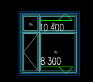
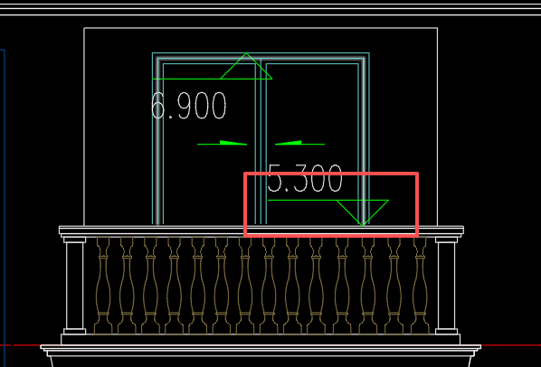

# 门窗标识与局部标高强制规则

用户确认的跨项目通用规则，适用于立面新建、深化和修订。门窗采用网站库件、项目 SU 或效果图时均执行。以下图例用于确定表达形式，实际数值和位置按本项目资料及最终几何核定。

## 门窗玻璃与开启标识

本节按用户 2026-11-19 确认的逐扇规则执行。每一樘组合门窗中的固定扇和开启扇分别识别、生成和验收。

| 扇型 | 应有标识 | 定位和方向 | 同扇互斥要求 |
| --- | --- | --- | --- |
| 固定玻璃扇 | 每个独立净玻璃分格一组成组短斜线玻璃符号 | 整组符号的中心与所属净玻璃分格中心重合 | 开启标识应为零组 |
| 平开等已核定开启扇 | 只画所属开启方式的开启符号；平开扇用两条斜线组成一组 | 按实际开启方式、铰接侧及该扇边界确定方向和端点 | 玻璃符号应为零组 |
| 推拉扇 | 只画对应推拉方向的水平箭头 | 按实际推拉方式和各扇方向定位 | 玻璃符号应为零组 |

- **逐扇确定类型。** 记录门窗实例、扇或分格唯一标识、固定或开启类型、开启方式、方向依据和最终边界。门窗内含固定上亮、固定侧窗和开启扇时，各部分关联自己的类型。开启扇内的玻璃分格继承所属开启扇的标识规则。类型或开启方向从库件、项目图模、节点或已确认设计条件核定，依据缺失的扇定位记录待核。
- **固定玻璃居中。** 以该分格扣除框、梃和套边后的实际净玻璃轮廓定位。矩形分格的中心取净玻璃区域宽、高各自中点，成组短斜线以整组符号的中心对齐。弧形或异形分格按实际轮廓确定中心和符号容纳范围，记录定位依据；中心容纳不足时列为待协调。符号比例结合当前出图比例调整，并在中心位置检查与框梃的净距。文字、尺寸和局部标高避让玻璃符号，保持符号居中。
- **开启符号对应实际扇。** 开启扇只生成所属类型的开启符号，并核对铰接侧、推拉方向及符号端点。固定玻璃符号与开启符号在同一扇互斥。同一组合门窗可在不同扇分别具有相应符号。
- **随几何联动。** 库件适配、尺寸或分格调整、镜像、旋转和排版变换后，按最终扇型、净玻璃轮廓及变换重新核算符号中心、端点和方向。镜像后复核实际开启关系。符号关联随块和实例保留。
- **整组处理既有符号。** 导入库件和重跑生成时，先识别顶层及嵌套块中的既有玻璃与开启标识，按逐扇清单复用、纠偏、补齐或清除混标和重复组。同一标识的多条短斜线或两条开启线合为一组核验。型材密线清理按用途保护这些标识，并在清理后重新核对覆盖。
- **图层与图例。** 开启线及推拉箭头沿用现行开启线层，玻璃符号归门窗层，展开后核对有效层色。下列图例用于确定符号形状，适用扇型、居中位置与同扇互斥按上表执行。

## 局部标高覆盖

1. **门窗底部和顶部。** 每个适用立面、每层建立门窗下口与上口标高清单，门底按门槛控制面，窗底按窗台洞口下口，顶标高按对应门窗上口核定。底顶标高均指向实际控制边，结合本项目零点实测。
2. **同层代表标注。** 仅在同一立面、同一层中，对底顶标高均相同的一组门窗选一樘标注这一对标高。记录代表实例及所覆盖的门窗实例。底或顶标高不同的分别表达，各层分别选代表。
3. **阳台栏杆顶部。** 每层阳台必须标明栏杆顶部标高。同层存在不同栏杆顶高时分别表达，尖点指向栏杆顶部的实际控制位置。
4. **屋顶、天沟和檐口。** 屋脊及不同高低屋面的控制点、天沟和檐口均须有对应局部标高。记录每个测点的构件与控制面，逐向核对适用的屋面、天沟及檐口范围。
5. **数值、类型和排布。** 所有标高以米表示，保留三位小数，使用本项目零点和实际几何计算。沿用现行真实原生标高对象和样式规则，尖点与真实测点对齐。调整文字或符号姿态避让框梃、玻璃标识、开启标识、尺寸和其他标注。

### 门窗控制边与标高取值

- **逐实例绑定。** 每樘记录原生实例路径或句柄、宿主墙面、楼层、视向、洞口及实际下口/上口控制边。门底采用已核定门槛控制面，窗底采用窗台洞口下口，上口采用对应门窗洞口上口；框扇外缘、窗套顶底和装饰线脚另列用途。包围盒、最近距离和名称只用于筛候选，采用前必须核对宿主、所在平面、实际轮廓及实例关系，防止相邻、上下层或凹进门窗串配。异形或斜边的控制位置须有项目依据。
- **核定零点和变换。** 登记项目±0.000与源模型坐标的对应、单位、实例嵌套变换及楼层基准，以实际控制边坐标换算标高。立面排版平移不计入建筑标高。零点、门槛做法或控制边未定时，保留原测值和待核原因，不将暂定基准写成已核定值。
- **几何变化重算。** 库件适配、洞口调整、镜像、构件移动及版本更换后，重新关联控制边、测点和应有标高，联动框套及相邻收口。禁止继续使用旧测点或手改显示数字抵消几何错误。
- **分组保留真实差异。** 代表分组依据已核定底顶控制标高及控制语义，采用有来源的计算容差。不得先用整数截断或三位小数显示值合并分组；浮点尾差与真实高差分别登记。数值格式化放在最终表达阶段，原始坐标、实测值、采用值及依据保留。

### 局部门窗标高无引线

- 门窗下口、上口标高使用真实天正标高对象，三角尖点落在所标实际控制边，**不带引线，不带伸向尺寸线或测点的延长测量接线**。保留空心三角及承托数字的水平短线。双侧主标高仍按现行规则以原生基线接第二道竖向尺寸线；本项不扩为其他局部构件标高的统一样式。
- 克隆原型、库件或旧图对象时，显式区分门窗局部标高与主标高，清除继承的引线/测量接线状态。已验证的原生实现可关闭 `HasLeader` 和 `HasBaseLine`；属性名称、值和能力以当前天正版本实测为准。关闭后核实三角、数字横线、实际值和尖点未被破坏。属性不支持或修改失败时记录未通过，不能仅删可见线或以普通线文替代真天正对象。
- 避让采用可读的文字位置及允许的符号姿态，尖点和控制值保持关联。不得为排版把尖点移离控制边、自动加引线，或用另一条同高边代替所标构件。保存重开后读取属性并检查实际图形及嵌套内容，确认无引线复现、残留接线或额外叠加线。

## 出图和保存重开验收

- 门窗清单按“立面—门窗实例—扇或净玻璃分格”逐项记录应有符号类型、应有组数、实际组数、固定玻璃中心坐标、实际符号中心、开启方式与方向、采用依据及待核状态。固定玻璃每个独立净玻璃分格应有一组居中玻璃符号且开启符号为零组；开启扇应有对应类型的一组开启符号且玻璃符号为零组，组合开启方式按已核定表达登记应有组数。库件自带和嵌套块内符号一并核查。
- 从四向保存重开的 DWG 展开各门窗及嵌套块，核对实际符号所属扇、覆盖、中心偏差、方向、图层及可见性。中心核验容差按当前单位与计算精度记录，并在目标出图比例检查居中和净距。符号漏标、非居中、重复组或同扇混标的条目逐扇修正并复核；每樘符号总数相同仍须检查扇与符号的实际对应关系。
- 局部标高清单记录立面、楼层、控制语义、构件实例或代表分组、覆盖对象、零点、测点坐标、实际值及原生标高对象。逐项核验门窗底顶、各层栏杆顶、屋顶、天沟和檐口，数值相同的不同控制语义分别核对。
- 门窗清单补记宿主、源控制边、坐标变换、源实测值、采用值及对应DWG句柄；从当前源资料独立复量，再对照重开DWG的尖点、实际业务值和控制边几何。门窗局部标高逐项核对无引线、无测量接线及三角和数字横线完整，主标高另核其基线连接。生成脚本的同一张预期表只能用于一致性检查，不能独自证明测点选择和数值正确。
- 局部标高代表分组按本节门窗规则执行。左右主标高仍按现行双侧主标高规则逐侧验收。局部覆盖不足或标识方向待核的实例，在验收记录中逐项定位。
- 从保存重开的 DWG 核对标识和标高对象的实际几何、图层、文字方向、对应测点及可见性，并在当前出图比例和打印窗口中检查避让、重叠及裁切。
