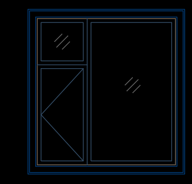
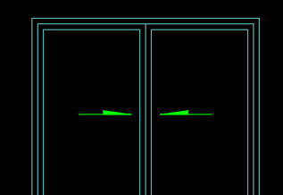
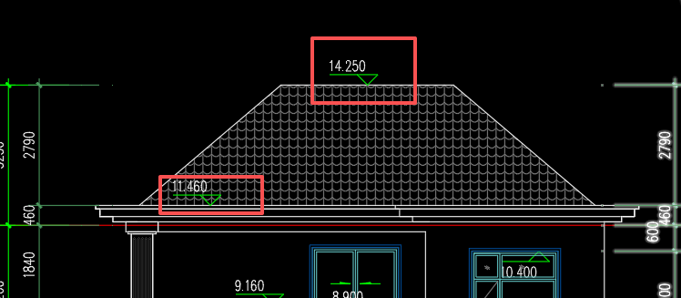

# 门窗标识与局部标高强制规则

用户确认的跨项目通用规则，适用于立面新建、深化和修订。门窗采用网站库件、项目 SU 或效果图时均执行。以下图例用于确定表达形式，实际数值和位置按本项目资料及最终几何核定。

## 门窗玻璃与开启标识

- 逐樘登记各玻璃分格、固定扇、开启扇及开启类型。玻璃分格内必须添加参考图所示的成组短斜线玻璃标识，布置在能清楚阅读且避让框梃和标注的位置。
- 平开扇必须画两条斜线组成的开启标识，按实际开启方式和铰接侧确定尖角及斜线方向。推拉扇必须画水平箭头，方向对应各扇的实际推拉方向。固定扇按固定玻璃表达。
- 开启类型、铰接侧和方向依据库件原件、项目图模、节点或已确认的设计条件核定。原件仅能证实独立扇框时，继续查证方向并逐樘记录待核项，交付核验列明尚未完成的标识。
- 库件适配洞口尺寸后，联动调整标识位置，关联所属玻璃或开启扇。开启线及推拉箭头按现行开启线层归层，玻璃标识按门窗层归层，重开后检查块内有效层色和图面可读性。

## 局部标高覆盖

1. **门窗底部和顶部。** 每个适用立面、每层建立门窗下口与上口标高清单，门底按门槛控制面，窗底按窗台洞口下口，顶标高按对应门窗上口核定。底顶标高均指向实际控制边，结合本项目零点实测。
2. **同层代表标注。** 仅在同一立面、同一层中，对底顶标高均相同的一组门窗选一樘标注这一对标高。记录代表实例及所覆盖的门窗实例。底或顶标高不同的分别表达，各层分别选代表。
3. **阳台栏杆顶部。** 每层阳台必须标明栏杆顶部标高。同层存在不同栏杆顶高时分别表达，尖点指向栏杆顶部的实际控制位置。
4. **屋顶、天沟和檐口。** 屋脊及不同高低屋面的控制点、天沟和檐口均须有对应局部标高。记录每个测点的构件与控制面，逐向核对适用的屋面、天沟及檐口范围。
5. **数值、类型和排布。** 所有标高以米表示，保留三位小数，使用本项目零点和实际几何计算。沿用现行真实原生标高对象和样式规则，尖点与真实测点对齐。调整文字或符号姿态避让框梃、玻璃标识、开启标识、尺寸和其他标注。

## 出图和保存重开验收

- 门窗清单逐实例核对玻璃标识、开启类型、标识方向、采用依据及待核状态，覆盖固定玻璃、平开和推拉等本项目实际类型。库件自带的标识也须核查。
- 局部标高清单记录立面、楼层、控制语义、构件实例或代表分组、覆盖对象、零点、测点坐标、实际值及原生标高对象。逐项核验门窗底顶、各层栏杆顶、屋顶、天沟和檐口，数值相同的不同控制语义分别核对。
- 局部标高代表分组按本节门窗规则执行。左右主标高仍按现行双侧主标高规则逐侧验收。局部覆盖不足或标识方向待核的实例，在验收记录中逐项定位。
- 从保存重开的 DWG 核对标识和标高对象的实际几何、图层、文字方向、对应测点及可见性，并在当前出图比例和打印窗口中检查避让、重叠及裁切。
